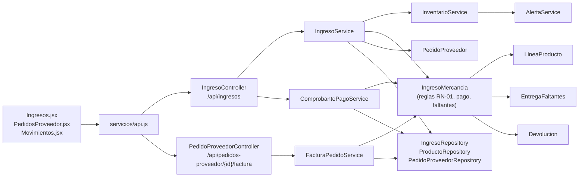

# Diagnóstico técnico y refactorización — F-06 Validar pedidos recibidos y pagar al proveedor

Ingeniería de Software II · Taller de refactorización y cierre de arquitectura

## 1. Contexto

| | |
|---|---|
| **Equipo** | Juan David Castañeda, Catalina Clavijo, Ivan Dario Guerrero |
| **Repositorio** | https://github.com/juanda724/tienda-barrio (rama `main`) |
| **Versión analizada** | Commit `e5cecec` (en `main`) |
| **Funcionalidad** | **F-06 · Validar pedidos recibidos del proveedor**: recibir la mercancía, confrontar la factura con lo recibido, resolver las diferencias (ajuste de factura o entrega posterior de faltantes), pagar al proveedor y emitir el comprobante de pago y la factura del pedido. |
| **Requisitos** | SWR-15, SWR-16, SWR-17 (verificación y bloqueo del pago), SWR-27 (entregas posteriores de faltantes), SWR-28 (pago de contado o a crédito con cambio), SWR-29 (comprobante de pago y factura del pedido) y la regla **RN-01** (no se paga con diferencias sin resolver ni con una devolución en curso). Plan Vivo de Requisitos v0.4; épico Jira **PS2-7**, historia **PS2-15**. |

Es una transacción de negocio que involucra varias entidades: `IngresoMercancia`, `LineaProducto`, `Producto`,
`MovimientoInventario`, `PedidoProveedor`, `EntregaFaltantes`, `Devolucion` y `Proveedor`.

## 2. Arquitectura real

Backend Spring Boot 3.5 (Java 21) por capas — `controller` → `service` → `model` / `repository` → H2 — y
frontend React 19 que consume la API REST.

**Flujo de la funcionalidad**

1. `POST /api/ingresos` → `IngresoService.registrar()` valida proveedor y productos, suma el stock con
   `InventarioService.registrarEntrada()`, guarda las líneas (facturado vs. recibido), llama a
   `IngresoMercancia.verificar()` (SWR-15, SWR-17) y marca el pedido como Entregado.
2. Si hay diferencias: `POST /{id}/resolver-diferencias` (ajuste de factura) o `POST /{id}/entregas-faltantes`
   (SWR-27), ambos resueltos en `IngresoMercancia`.
3. `POST /{id}/pago` → `IngresoService.pagar()` → `IngresoMercancia.pagar()` / `acordarCredito()`, que aplican
   RN-01 en `validarQueSePuedePagar()` (SWR-16) y calculan el total con `getTotalAPagar()` (SWR-28).
4. `GET /api/ingresos/{id}/comprobante-pago` → `ComprobantePagoService` y
   `GET /api/pedidos-proveedor/{id}/factura` → `FacturaPedidoService` arman los documentos (SWR-29).

**Pruebas que protegen la funcionalidad** (antes de intervenir, 74/74 en verde en todo el backend):
`VerificacionPagoTest` (11), `EntregaFaltantesTest` (7), `PedidosProveedorTest` (10, incluye la factura) y
`DevolucionesTest` (9, notas crédito y RN-01).

## 3. Hallazgos

Las rutas son relativas a `backend/src/main/java/co/tiendabarrio/`; las líneas corresponden al commit `e5cecec`.

### H-01 · Regla de "cantidad cobrada" duplicada fuera del dominio

| | |
|---|---|
| **Tipo** | Riesgo arquitectónico |
| **Ubicación** | `service/FacturaPedidoService.java`, método `generar()`, líneas 61–69, frente a `model/IngresoMercancia.java`, método `getTotalAPagar()`, líneas 274–278 |
| **Evidencia** | Dominio: `long base = resultadoVerificacion == ResultadoVerificacion.DIFERENCIAS_RESUELTAS ? getTotalRecibido() : getTotalFacturado();` · Servicio: `boolean porRecibido = ingreso.getResultadoVerificacion() == ResultadoVerificacion.DIFERENCIAS_RESUELTAS;` y `int cobrada = porRecibido ? l.getCantidadRecibidaTotal() : l.getCantidadFacturada();` — el propio comentario de la línea 61 dice "igual que el pago". |
| **Observación** | La regla de negocio "si la factura se ajustó a lo recibido se paga lo recibido; si no, lo facturado" está escrita dos veces: en la entidad, que decide cuánto se paga, y en el servicio de la factura, que la reimplementa línea por línea para mostrar el detalle. El servicio además decide a partir del estado interno de la verificación de la entidad. |
| **Criterio** | Experto en información (GRASP) y encapsulamiento del dominio: la entidad que tiene los datos debe ser la única que aplique la regla. DRY. Separación de capas: la capa de servicio no debería conocer reglas de cálculo del dominio. |
| **Impacto y riesgo** | Si la regla cambia (por ejemplo, otra forma de resolver diferencias), basta con actualizar uno de los dos lugares para que la **factura del pedido deje de coincidir con lo pagado**: el subtotal de la factura menos las notas crédito ya no daría el TOTAL PAGADO. Es dinero frente al proveedor y ninguna prueba compara hoy los dos cálculos entre sí. |
| **Acción propuesta** | Mover la regla a `IngresoMercancia` (`getCantidadCobrada(linea)`, `getSubtotalCobrado(linea)`, `getTotalCobrado()`), hacer que `getTotalAPagar()` la use y que `FacturaPedidoService` solo la consulte. |
| **Verificación** | Pruebas de caracterización que fijan el texto y los valores de la factura y del comprobante antes del cambio (incluido el caso de factura ajustada), más una prueba nueva que exige que el subtotal de la factura menos las notas crédito sea igual al total pagado. |
| **Estado** | Seleccionado |

### H-02 · Bloques del documento de pago duplicados en dos servicios

| | |
|---|---|
| **Tipo** | Deuda técnica |
| **Ubicación** | `service/ComprobantePagoService.java`, método `texto()`, líneas 27, 72–90 · `service/FacturaPedidoService.java`, método `texto()`, líneas 35, 118–132 |
| **Evidencia** | Mismo formateador en ambos (`DateTimeFormatter.ofPattern("dd/MM/yyyy hh:mm a")`, líneas 27 y 35); mismo armado de cada entrega posterior (`String.join(", ", ... l.getCantidad() + " x " + l.getProducto().getNombre())`, líneas 76–77 y 122–123); mismo bloque de pago, idéntico carácter por carácter (`"TOTAL PAGADO: "`, `"Forma de pago: "`, `"Efectivo entregado: "`, `"Cambio devuelto: "`, líneas 85–90 y 127–132). |
| **Observación** | Los dos documentos sobre el mismo pago se arman copiando el mismo código. Cada servicio mezcla dos responsabilidades: obtener y validar los datos del pago, y redactar los bloques de texto comunes. |
| **Criterio** | DRY y responsabilidad única (SRP): la redacción del pago al proveedor es una responsabilidad propia que hoy está repartida en dos clases. |
| **Impacto y riesgo** | Un cambio de formato (fecha, moneda, una línea nueva como "Saldo a favor") hay que repetirlo en los dos lugares; si se olvida uno, el comprobante y la factura del mismo pago muestran información distinta. Riesgo moderado: el texto también se envía al proveedor por WhatsApp y Gmail. |
| **Acción propuesta** | Extraer un componente `RedaccionPagoProveedor` con el formato de fecha, el detalle de una entrega posterior y el bloque de pago, y hacer que ambos servicios lo usen conservando exactamente su texto actual. |
| **Verificación** | Las mismas pruebas de caracterización de H-01: el texto de ambos documentos debe ser idéntico antes y después. |
| **Estado** | Seleccionado |

### H-03 · `IngresoService.registrar()` concentra seis responsabilidades

| | |
|---|---|
| **Tipo** | Deuda técnica |
| **Ubicación** | `service/IngresoService.java`, método `registrar()`, líneas 66–103 |
| **Evidencia** | En un mismo método: valida el proveedor (68–69), normaliza el número de factura (70–71), valida el pedido (72), agrupa y valida las líneas (73–76), valida que el proveedor suministre cada producto (84–89), mueve el inventario (90–92), **actualiza el costo del catálogo** (`producto.setCosto(linea.costoUnitario())`, línea 93), verifica la factura (98) y cierra el pedido (99–101). |
| **Observación** | El método mezcla validación, reglas de inventario, mantenimiento del catálogo de productos y la transición de estado del pedido. La actualización del costo es un efecto lateral poco visible para quien registra un ingreso. |
| **Criterio** | Responsabilidad única (SRP); legibilidad. |
| **Impacto y riesgo** | Cualquier cambio en una de esas reglas obliga a tocar la transacción central de la funcionalidad. Las pruebas actuales la cubren, por lo que el riesgo inmediato es bajo. |
| **Acción propuesta** | Extraer métodos con nombre (`validarLineas`, `registrarLinea`, `actualizarCostoDelCatalogo`) o un componente de recepción, sin cambiar la transacción. |
| **Verificación** | `VerificacionPagoTest`, `ProveedoresIngresoTest` y `PedidosProveedorTest`. |
| **Estado** | Pendiente |

### H-04 · La decisión "contado o crédito" está repartida entre servicio y dominio

| | |
|---|---|
| **Tipo** | Oportunidad de mejora |
| **Ubicación** | `service/IngresoService.java`, método `pagar()`, líneas 145–152 · `model/IngresoMercancia.java`, método `pagar()`, líneas 180–182 |
| **Evidencia** | El servicio decide: `if (datos.formaPago() == FormaPago.CREDITO) { ... ingreso.acordarCredito(...) } else { ingreso.pagar(...) }`; la entidad vuelve a comprobar la misma condición: `if (formaPago == FormaPago.CREDITO) { throw new NegocioException("Para pagar a crédito use \"Acordar crédito\""); }`. |
| **Observación** | Una regla del pago vive en dos capas. Funciona, pero la entidad no expone una sola operación "registrar pago". |
| **Criterio** | Separación de capas; el dominio debería tomar las decisiones del negocio. |
| **Impacto y riesgo** | Bajo: hoy ambos lugares son coherentes. |
| **Acción propuesta** | Un único método de dominio `registrarPago(formaPago, vencimiento, entregado)`. |
| **Verificación** | `VerificacionPagoTest`. |
| **Estado** | Pendiente |

### H-05 · Consultas N+1 al listar los pedidos a proveedor

| | |
|---|---|
| **Tipo** | Riesgo (rendimiento) |
| **Ubicación** | `service/PedidoProveedorService.java`, método `listar()`, línea 54, y `ingresoDe()`, líneas 112–116 |
| **Evidencia** | `lista.stream().map(this::respuesta)` y, por cada pedido entregado, `ingresos.findFirstByPedidoIdOrderByIdDesc(pedido.getId())`. |
| **Observación** | Para mostrar si el pedido ya está pagado, se hace una consulta adicional por cada pedido entregado. |
| **Criterio** | Eficiencia y escalabilidad. |
| **Impacto y riesgo** | Bajo en una tienda de barrio (pocos pedidos); crece linealmente con el historial. |
| **Acción propuesta** | Una sola consulta con `JOIN` o traer los ingresos de todos los pedidos de una vez. |
| **Verificación** | `PedidosProveedorTest`. |
| **Estado** | Pendiente |

### Observación sin cambio de código

**O-01.** La factura del pedido no muestra la nota de cada entrega posterior de faltantes y el comprobante de pago
sí (`FacturaPedidoService.java:120–125` frente a `ComprobantePagoService.java:78–80`). Es una diferencia de
contenido visible para el usuario; como la refactorización debe conservar el comportamiento, **no se modifica**
y queda registrada para que el equipo decida si es intencional.

## 4. Priorización

Escala 1 (bajo) a 3 (alto).

| ID | Impacto | Riesgo | Esfuerzo | Decisión |
|---|:---:|:---:|:---:|---|
| H-01 | 3 | 3 | 1 | **Seleccionado** |
| H-02 | 2 | 2 | 1 | **Seleccionado** |
| H-03 | 2 | 2 | 3 | Pendiente |
| H-04 | 1 | 1 | 2 | Pendiente |
| H-05 | 1 | 1 | 2 | Pendiente |

**Razón de la selección.** H-01 tiene el mayor impacto (afecta dinero frente al proveedor) y el menor esfuerzo,
y H-02 está en los mismos dos servicios: tratarlos juntos permite dejar en un solo lugar tanto la regla de
cálculo (dominio) como la redacción común (servicio), con un cambio acotado y fácil de verificar. H-03 tiene buen
impacto, pero toca la transacción central con un esfuerzo mayor; H-04 y H-05 son de bajo riesgo hoy.

## 5. Intervención

_Pendiente (sesión 2)._

## 6. Verificación

_Pendiente (sesión 2)._

## 7. Cierre

_Pendiente (sesión 2)._

## 8. Git

| Paso | Commit |
|---|---|
| Diagnóstico | _pendiente_ |
| Pruebas de caracterización | _pendiente_ |
| Refactorización | _pendiente_ |
| Verificación | _pendiente_ |
