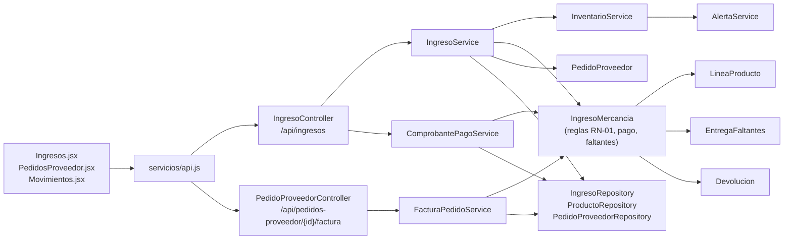
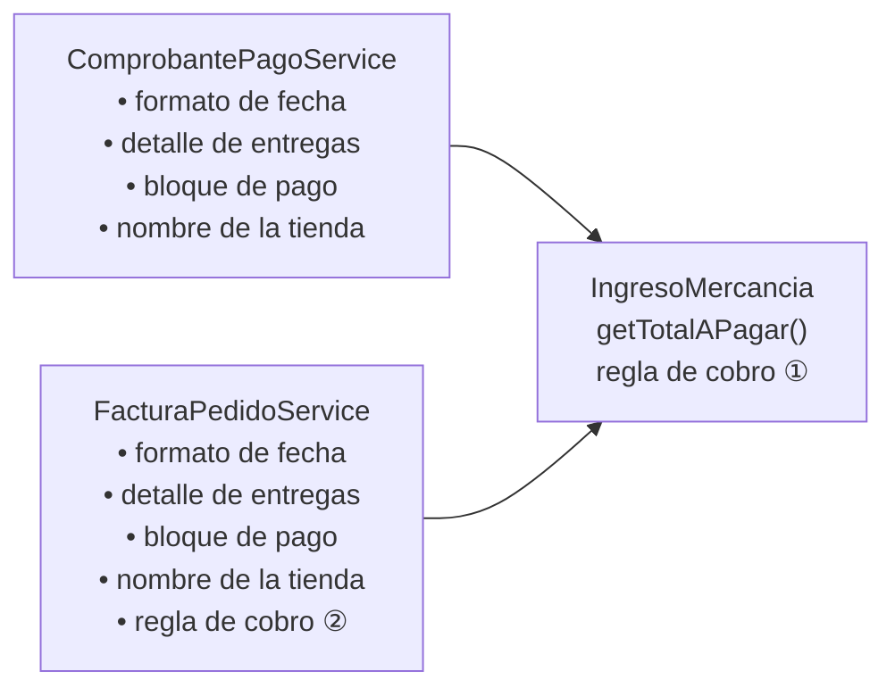
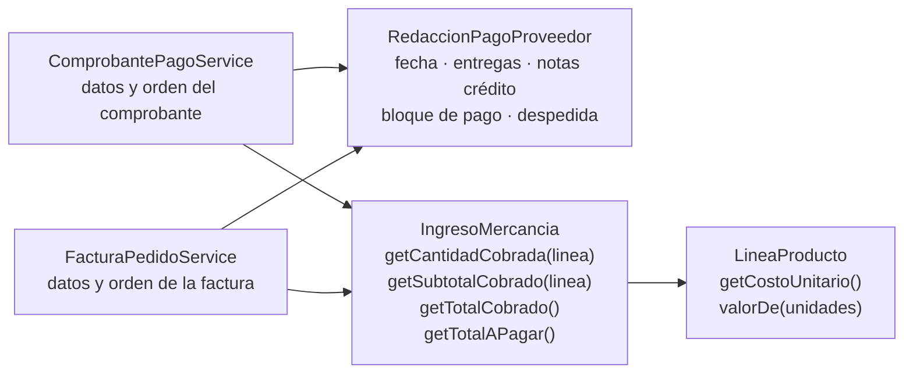

# Diagnóstico técnico y refactorización — F-06 Validar pedidos recibidos y pagar al proveedor

Ingeniería de Software II · Taller de refactorización y cierre de arquitectura

## 1. Contexto

| | |
|---|---|
| **Equipo** | Juan David Castañeda, Catalina Clavijo, Ivan Dario Guerrero |
| **Repositorio** | https://github.com/juanda724/tienda-barrio (rama `main`) |
| **Versión analizada** | Commit `e5cecec` (en `main`) |
| **Funcionalidad** | **F-06 · Validar pedidos recibidos del proveedor**: recibir la mercancía, confrontar la factura con lo recibido, resolver las diferencias (ajuste de factura o entrega posterior de faltantes), pagar al proveedor y emitir el comprobante de pago y la factura del pedido. |
| **Requisitos** | SWR-15, SWR-16, SWR-17 (verificación y bloqueo del pago), SWR-27 (entregas posteriores de faltantes), SWR-28 (pago de contado o a crédito con cambio), SWR-29 (comprobante de pago y factura del pedido) y la regla **RN-01** (no se paga con diferencias sin resolver ni con una devolución en curso). Plan Vivo de Requisitos v0.4; épico Jira **PS2-7**, historia **PS2-15**. |

Es una transacción de negocio que involucra varias entidades: `IngresoMercancia`, `LineaProducto`, `Producto`,
`MovimientoInventario`, `PedidoProveedor`, `EntregaFaltantes`, `Devolucion` y `Proveedor`.

## 2. Arquitectura real

Backend Spring Boot 3.5 (Java 21) por capas — `controller` → `service` → `model` / `repository` → H2 — y
frontend React 19 que consume la API REST.



**Flujo de la funcionalidad**

1. `POST /api/ingresos` → `IngresoService.registrar()` valida proveedor y productos, suma el stock con
   `InventarioService.registrarEntrada()`, guarda las líneas (facturado vs. recibido), llama a
   `IngresoMercancia.verificar()` (SWR-15, SWR-17) y marca el pedido como Entregado.
2. Si hay diferencias: `POST /{id}/resolver-diferencias` (ajuste de factura) o `POST /{id}/entregas-faltantes`
   (SWR-27), ambos resueltos en `IngresoMercancia`.
3. `POST /{id}/pago` → `IngresoService.pagar()` → `IngresoMercancia.pagar()` / `acordarCredito()`, que aplican
   RN-01 en `validarQueSePuedePagar()` (SWR-16) y calculan el total con `getTotalAPagar()` (SWR-28).
4. `GET /api/ingresos/{id}/comprobante-pago` → `ComprobantePagoService` y
   `GET /api/pedidos-proveedor/{id}/factura` → `FacturaPedidoService` arman los documentos (SWR-29).

**Pruebas que protegen la funcionalidad** (antes de intervenir, 74/74 en verde en todo el backend):
`VerificacionPagoTest` (11), `EntregaFaltantesTest` (7), `PedidosProveedorTest` (10, incluye la factura) y
`DevolucionesTest` (9, notas crédito y RN-01).

## 3. Hallazgos

Las rutas son relativas a `backend/src/main/java/co/tiendabarrio/`; las líneas corresponden al commit `e5cecec`.

### H-01 · Regla de "cantidad cobrada" duplicada fuera del dominio

| | |
|---|---|
| **Tipo** | Riesgo arquitectónico |
| **Ubicación** | `service/FacturaPedidoService.java`, método `generar()`, líneas 61–69, frente a `model/IngresoMercancia.java`, método `getTotalAPagar()`, líneas 274–278 |
| **Evidencia** | Dominio: `long base = resultadoVerificacion == ResultadoVerificacion.DIFERENCIAS_RESUELTAS ? getTotalRecibido() : getTotalFacturado();` · Servicio: `boolean porRecibido = ingreso.getResultadoVerificacion() == ResultadoVerificacion.DIFERENCIAS_RESUELTAS;` y `int cobrada = porRecibido ? l.getCantidadRecibidaTotal() : l.getCantidadFacturada();` — el propio comentario de la línea 61 dice "igual que el pago". |
| **Observación** | La regla de negocio "si la factura se ajustó a lo recibido se paga lo recibido; si no, lo facturado" está escrita dos veces: en la entidad, que decide cuánto se paga, y en el servicio de la factura, que la reimplementa línea por línea para mostrar el detalle. El servicio además decide a partir del estado interno de la verificación de la entidad. |
| **Criterio** | Experto en información (GRASP) y encapsulamiento del dominio: la entidad que tiene los datos debe ser la única que aplique la regla. DRY. Separación de capas: la capa de servicio no debería conocer reglas de cálculo del dominio. |
| **Impacto y riesgo** | Si la regla cambia (por ejemplo, otra forma de resolver diferencias), basta con actualizar uno de los dos lugares para que la **factura del pedido deje de coincidir con lo pagado**: el subtotal de la factura menos las notas crédito ya no daría el TOTAL PAGADO. Es dinero frente al proveedor y ninguna prueba compara hoy los dos cálculos entre sí. |
| **Acción propuesta** | Mover la regla a `IngresoMercancia` (`getCantidadCobrada(linea)`, `getSubtotalCobrado(linea)`, `getTotalCobrado()`), hacer que `getTotalAPagar()` la use y que `FacturaPedidoService` solo la consulte. |
| **Verificación** | Pruebas de caracterización que fijan el texto y los valores de la factura y del comprobante antes del cambio (incluido el caso de factura ajustada), más una prueba nueva que exige que el subtotal de la factura menos las notas crédito sea igual al total pagado. |
| **Estado** | Verificado (commit `d55e458`, secciones 5.1 y 6.1) |

### H-02 · Bloques del documento de pago duplicados en dos servicios

| | |
|---|---|
| **Tipo** | Deuda técnica |
| **Ubicación** | `service/ComprobantePagoService.java`, método `texto()`, líneas 27, 72–90 · `service/FacturaPedidoService.java`, método `texto()`, líneas 35, 118–132 |
| **Evidencia** | Mismo formateador en ambos (`DateTimeFormatter.ofPattern("dd/MM/yyyy hh:mm a")`, líneas 27 y 35); mismo armado de cada entrega posterior (`String.join(", ", ... l.getCantidad() + " x " + l.getProducto().getNombre())`, líneas 76–77 y 122–123); mismo bloque de pago, idéntico carácter por carácter (`"TOTAL PAGADO: "`, `"Forma de pago: "`, `"Efectivo entregado: "`, `"Cambio devuelto: "`, líneas 85–90 y 127–132). |
| **Observación** | Los dos documentos sobre el mismo pago se arman copiando el mismo código. Cada servicio mezcla dos responsabilidades: obtener y validar los datos del pago, y redactar los bloques de texto comunes. |
| **Criterio** | DRY y responsabilidad única (SRP): la redacción del pago al proveedor es una responsabilidad propia que hoy está repartida en dos clases. |
| **Impacto y riesgo** | Un cambio de formato (fecha, moneda, una línea nueva como "Saldo a favor") hay que repetirlo en los dos lugares; si se olvida uno, el comprobante y la factura del mismo pago muestran información distinta. Riesgo moderado: el texto también se envía al proveedor por WhatsApp y Gmail. |
| **Acción propuesta** | Extraer un componente `RedaccionPagoProveedor` con el formato de fecha, el detalle de una entrega posterior y el bloque de pago, y hacer que ambos servicios lo usen conservando exactamente su texto actual. |
| **Verificación** | Las mismas pruebas de caracterización de H-01: el texto de ambos documentos debe ser idéntico antes y después. |
| **Estado** | Verificado (commit `d55e458`, secciones 5.1 y 6.1) |

### H-03 · `IngresoService.registrar()` concentra seis responsabilidades

| | |
|---|---|
| **Tipo** | Deuda técnica |
| **Ubicación** | `service/IngresoService.java`, método `registrar()`, líneas 66–103 |
| **Evidencia** | En un mismo método: valida el proveedor (68–69), normaliza el número de factura (70–71), valida el pedido (72), agrupa y valida las líneas (73–76), valida que el proveedor suministre cada producto (84–89), mueve el inventario (90–92), **actualiza el costo del catálogo** (`producto.setCosto(linea.costoUnitario())`, línea 93), verifica la factura (98) y cierra el pedido (99–101). |
| **Observación** | El método mezcla validación, reglas de inventario, mantenimiento del catálogo de productos y la transición de estado del pedido. La actualización del costo es un efecto lateral poco visible para quien registra un ingreso. |
| **Criterio** | Responsabilidad única (SRP); legibilidad. |
| **Impacto y riesgo** | Cualquier cambio en una de esas reglas obliga a tocar la transacción central de la funcionalidad. Las pruebas actuales la cubren, por lo que el riesgo inmediato es bajo. |
| **Acción propuesta** | Extraer métodos con nombre (`validarLineas`, `registrarLinea`, `actualizarCostoDelCatalogo`) o un componente de recepción, sin cambiar la transacción. |
| **Verificación** | `VerificacionPagoTest`, `ProveedoresIngresoTest` y `PedidosProveedorTest`, más las pruebas de caracterización de `RegistroIngresoCaracterizacionTest` (sección 6.2). |
| **Estado** | Verificado (commit `af57415`, secciones 5.2 y 6.2) |

### H-04 · La decisión "contado o crédito" está repartida entre servicio y dominio

| | |
|---|---|
| **Tipo** | Oportunidad de mejora |
| **Ubicación** | `service/IngresoService.java`, método `pagar()`, líneas 145–152 · `model/IngresoMercancia.java`, método `pagar()`, líneas 180–182 |
| **Evidencia** | El servicio decide: `if (datos.formaPago() == FormaPago.CREDITO) { ... ingreso.acordarCredito(...) } else { ingreso.pagar(...) }`; la entidad vuelve a comprobar la misma condición: `if (formaPago == FormaPago.CREDITO) { throw new NegocioException("Para pagar a crédito use \"Acordar crédito\""); }`. |
| **Observación** | Una regla del pago vive en dos capas. Funciona, pero la entidad no expone una sola operación "registrar pago". |
| **Criterio** | Separación de capas; el dominio debería tomar las decisiones del negocio. |
| **Impacto y riesgo** | Bajo: hoy ambos lugares son coherentes. |
| **Acción propuesta** | Un único método de dominio `registrarPago(formaPago, vencimiento, entregado)`. |
| **Verificación** | `VerificacionPagoTest`. |
| **Estado** | Pendiente |

### H-05 · Consultas N+1 al listar los pedidos a proveedor

| | |
|---|---|
| **Tipo** | Riesgo (rendimiento) |
| **Ubicación** | `service/PedidoProveedorService.java`, método `listar()`, línea 54, y `ingresoDe()`, líneas 112–116 |
| **Evidencia** | `lista.stream().map(this::respuesta)` y, por cada pedido entregado, `ingresos.findFirstByPedidoIdOrderByIdDesc(pedido.getId())`. |
| **Observación** | Para mostrar si el pedido ya está pagado, se hace una consulta adicional por cada pedido entregado. |
| **Criterio** | Eficiencia y escalabilidad. |
| **Impacto y riesgo** | Bajo en una tienda de barrio (pocos pedidos); crece linealmente con el historial. |
| **Acción propuesta** | Una sola consulta con `JOIN` o traer los ingresos de todos los pedidos de una vez. |
| **Verificación** | `PedidosProveedorTest`. |
| **Estado** | Pendiente |

### Observación sin cambio de código

**O-01.** La factura del pedido no muestra la nota de cada entrega posterior de faltantes y el comprobante de pago
sí (`FacturaPedidoService.java:120–125` frente a `ComprobantePagoService.java:78–80`). Es una diferencia de
contenido visible para el usuario; como la refactorización debe conservar el comportamiento, **no se modifica**
y queda registrada para que el equipo decida si es intencional.

## 4. Priorización

Escala 1 (bajo) a 3 (alto).

| ID | Impacto | Riesgo | Esfuerzo | Decisión |
|---|:---:|:---:|:---:|---|
| H-01 | 3 | 3 | 1 | **Seleccionado** (1.ª refactorización) |
| H-02 | 2 | 2 | 1 | **Seleccionado** (1.ª refactorización) |
| H-03 | 2 | 2 | 3 | **Seleccionado** (2.ª refactorización) |
| H-04 | 1 | 1 | 2 | Pendiente |
| H-05 | 1 | 1 | 2 | Pendiente |

**Razón de la selección.** H-01 tiene el mayor impacto (afecta dinero frente al proveedor) y el menor esfuerzo,
y H-02 está en los mismos dos servicios: tratarlos juntos permite dejar en un solo lugar tanto la regla de
cálculo (dominio) como la redacción común (servicio), con un cambio acotado y fácil de verificar. H-03 tiene buen
impacto, pero toca la transacción central con un esfuerzo mayor; H-04 y H-05 son de bajo riesgo hoy.

**Segunda refactorización.** Con H-01 y H-02 resueltos, se seleccionó **H-03**: es el siguiente en impacto y
riesgo, y está en la misma funcionalidad (es el primer paso de F-06, la recepción del pedido). Su esfuerzo era el
mayor porque toca la transacción central; se redujo ese riesgo fijando antes todos sus efectos con pruebas de
caracterización. H-04 y H-05 siguen pendientes por su bajo impacto actual.

## 5. Intervención

### 5.1 Primera refactorización: H-01 y H-02

**Cambio elegido.** Refactorización de H-01 y H-02 (commit `d55e458`), sin cambiar el comportamiento observable:
no es una corrección de defecto. Técnicas aplicadas: *Move Method* (la regla de cobro pasa al dominio),
*Extract Class* (la redacción común pasa a un componente propio) y *Replace Duplicated Expression with Method*
(el valor de una cantidad de unidades en `LineaProducto`).

#### Diseño antes



La regla de cobro estaba en dos lugares (① y ②) y el texto común del pago, copiado en los dos servicios.

#### Diseño después



- **H-01.** `IngresoMercancia.getCantidadCobrada(linea)` es ahora la **única definición** de cuántas unidades se
  pagan. `getTotalAPagar()` se apoya en `getTotalCobrado()`, y `FacturaPedidoService` ya no consulta el estado de
  la verificación: le pregunta al ingreso (`ingreso.getCantidadCobrada(l)`, `ingreso.getSubtotalCobrado(l)`,
  `ingreso.getTotalCobrado()`). Se eliminaron la variable `porRecibido` y la dependencia del servicio con
  `ResultadoVerificacion`.

  ```java
  // Antes — FacturaPedidoService.generar()
  boolean porRecibido = ingreso.getResultadoVerificacion() == ResultadoVerificacion.DIFERENCIAS_RESUELTAS;
  int cobrada = porRecibido ? l.getCantidadRecibidaTotal() : l.getCantidadFacturada();

  // Después — la regla vive solo en IngresoMercancia
  public int getCantidadCobrada(LineaProducto linea) {
      return resultadoVerificacion == ResultadoVerificacion.DIFERENCIAS_RESUELTAS
              ? linea.getCantidadRecibidaTotal() : linea.getCantidadFacturada();
  }
  ```

- **H-02.** Nuevo componente Spring `RedaccionPagoProveedor`, inyectado en los dos servicios. Concentra el formato
  de fecha, el detalle de una entrega posterior, la línea de notas crédito, el bloque de pago (total, forma de
  pago, efectivo y cambio), la despedida y el nombre de la tienda. Cada servicio conserva **su propio orden y
  presentación**, porque los documentos no son idénticos (O-01): el componente solo reúne lo que ambos escriben
  igual.

| Elemento duplicado | Antes | Después |
|---|:---:|:---:|
| Regla de cantidad cobrada | 2 | 1 |
| `DateTimeFormatter` del documento | 2 | 1 |
| Detalle de productos de una entrega | 2 | 1 |
| Línea "Notas crédito por devoluciones" | 2 | 1 |
| Bloque TOTAL PAGADO / forma de pago / efectivo / cambio | 2 | 1 |
| Despedida "Gracias por su atención." | 2 | 1 |
| Inyección de `tienda.nombre` | 2 | 1 |
| `precio == null ? 0 : precio × cantidad` en `LineaProducto` (subtotales de ingreso) | 2 | 1 |

#### Archivos afectados

Rutas relativas a `backend/src/main/java/co/tiendabarrio/`.

| Archivo | Cambio | Líneas (+/−) |
|---|---|---|
| `model/IngresoMercancia.java` | Regla de cobro: `getCantidadCobrada`, `getSubtotalCobrado`, `getTotalCobrado`; `getTotalAPagar` la usa | +20 / −5 |
| `model/LineaProducto.java` | `getCostoUnitario()` y `valorDe(unidades)` | +12 / −2 |
| `service/RedaccionPagoProveedor.java` | Nuevo: redacción común del pago al proveedor | +63 / −0 |
| `service/ComprobantePagoService.java` | Usa la redacción compartida | +11 / −23 |
| `service/FacturaPedidoService.java` | Usa la regla del dominio y la redacción compartida | +21 / −36 |

No cambiaron controladores, DTO, rutas de la API ni el frontend: el contrato con la interfaz es el mismo.

### 5.2 Segunda refactorización: H-03

**Cambio elegido.** Refactorización de H-03 (commit `af57415`), sin cambiar el comportamiento observable: no es
una corrección de defecto. Técnicas aplicadas: *Extract Method* (cada paso de la transacción pasa a un método
con nombre de negocio), *Move Method* (la validación "el proveedor suministra el producto" pasa a la entidad
`Proveedor`) y *Rename / Intention-Revealing Name* (el efecto lateral sobre el catálogo queda explícito en
`actualizarCostoDelCatalogo`).

#### Diseño antes

`IngresoService.registrar()` tenía 37 líneas, con todos los pasos escritos uno tras otro dentro del mismo
método, incluido un `for` con tres condiciones anidadas. La validación del proveedor estaba copiada, con el mismo
mensaje, en `IngresoService` y en `PedidoProveedorService`:

```java
// Antes — el mismo bloque en IngresoService.registrar() y en PedidoProveedorService.crear()
if (!proveedor.suministra(producto)) {
    throw new NegocioException(producto.getNombre() + " no está asociado al proveedor "
            + proveedor.getNombre());
}
```

#### Diseño después

`registrar()` queda como **orquestador**: se lee como los pasos del negocio y delega cada uno.

```java
@Transactional
public IngresoResponse registrar(IngresoRequest datos) {
    Proveedor proveedor = buscarProveedor(datos.proveedorId());
    String factura = normalizarFactura(datos.numeroFactura());
    PedidoProveedor pedido = datos.pedidoId() == null ? null : buscarPedido(datos.pedidoId(), proveedor);
    List<LineaIngresoRequest> lineas = lineasConCantidades(datos.lineas());

    IngresoMercancia ingreso = ingresos.save(new IngresoMercancia(proveedor, factura, pedido));
    String referencia = referenciaDeMovimiento(proveedor, factura);
    for (LineaIngresoRequest linea : lineas) {
        recibirLinea(ingreso, proveedor, linea, referencia);
    }
    ingreso.verificar();
    cerrarPedido(pedido, ingreso);
    return IngresoResponse.de(ingreso);
}
```

| Responsabilidad | Antes | Después |
|---|---|---|
| Validar el proveedor | Dentro de `registrar()` | `buscarProveedor()` |
| Normalizar el número de factura | Dentro de `registrar()` | `normalizarFactura()` |
| Unir líneas repetidas, exigir cantidades y descartar las vacías | Dentro de `registrar()` (en dos sitios: antes del `for` y con un `continue`) | `lineasConCantidades()`, en un solo lugar |
| Validar que el proveedor suministra el producto | Copiado en `IngresoService` y `PedidoProveedorService` | `Proveedor.validarQueSuministra()` (dominio), usado por ambos |
| Mover el inventario y registrar la línea | Dentro del `for` | `recibirLinea()` |
| Actualizar el costo del catálogo | Una línea `producto.setCosto(...)` escondida en el `for` | `actualizarCostoDelCatalogo()`, con su regla documentada |
| Cerrar el pedido | Dentro de `registrar()` | `cerrarPedido()` |

| Medida de `registrar()` | Antes (`64ba17b`) | Después (`af57415`) |
|---|:---:|:---:|
| Líneas del método | 37 | 15 |
| Puntos de decisión (`if`, `for`, `?:`, `&&`, `\|\|`) | 12 | 2 |
| Complejidad ciclomática aproximada | 13 | 3 |
| Métodos privados con nombre de negocio | 0 | 8 |
| Copias del mensaje "no está asociado al proveedor" en servicios | 2 | 0 (vive en `Proveedor`) |

Para conservar exactamente el comportamiento se mantuvieron el orden de las validaciones (proveedor → pedido →
líneas → producto → suministro), el tipo `Long` del costo y la misma condición de descarte de líneas
(`!(recibida == 0 && facturada == 0)`), aunque la API ya rechaza cantidades negativas.

#### Archivos afectados

Rutas relativas a `backend/src/main/java/co/tiendabarrio/`.

| Archivo | Cambio | Líneas (+/−) |
|---|---|---|
| `service/IngresoService.java` | `registrar()` como orquestador y 8 métodos privados | +70 / −28 |
| `model/Proveedor.java` | Nuevo `validarQueSuministra(producto)` | +9 / −0 |
| `service/PedidoProveedorService.java` | Usa `proveedor.validarQueSuministra(producto)` | +1 / −4 |

No cambiaron la transacción (`@Transactional` sigue en `registrar()`), las dependencias que recibe el servicio,
los controladores, la API ni el frontend.

## 6. Verificación

### 6.1 Primera refactorización: H-01 y H-02

**Estrategia.** Antes de tocar el código se escribieron **pruebas de caracterización** (commit `fd28b3c`,
`backend/src/test/java/co/tiendabarrio/DocumentosPagoCaracterizacionTest.java`) que fijan el comportamiento
observable de los dos documentos tal como estaba:

- **Seis escenarios** que recorren todas las ramas de los dos documentos:
  1. pedido aprobado pagado por transferencia;
  2. pago en efectivo con cambio y dos productos;
  3. faltantes entregados en dos partes, una con nota;
  4. factura ajustada a lo recibido, con un proveedor sin contacto ni correo;
  5. nota crédito por devolución;
  6. ingreso sin pedido, que solo tiene comprobante.
- **Qué se compara** en cada escenario: el texto completo del comprobante y de la factura, los enlaces de
  WhatsApp y Gmail (decodificados), los valores del ingreso (facturado, recibido, a pagar, notas crédito, pagado,
  entregado, cambio) y el detalle de cada línea de la factura (pedida, facturada, recibida, cobrada, costo,
  subtotal).
- **Referencias.** El resultado se guardó en `backend/src/test/resources/caracterizacion/*.txt`, generado una
  sola vez con el código anterior (`-Dcaracterizacion.generar=true`). Sin esa opción, una referencia faltante
  hace fallar la prueba en vez de crearse en silencio.
- **Regla de H-01.** Cada escenario con pedido comprueba además que *subtotal de la factura − notas crédito =
  total pagado*.

| Ejecución | Código | Pruebas | Resultado | Evidencia |
|---|---|---:|---|---|
| Línea base | `e5cecec` | 74 | 74 OK, 0 fallos | `evidencias/01-linea-base-antes.txt` |
| Antes de refactorizar | `fd28b3c` (con caracterización) | 80 | 80 OK, 0 fallos | `evidencias/02-caracterizacion-antes.txt` |
| Después de refactorizar | `d55e458` | 80 | 80 OK, 0 fallos | `evidencias/03-caracterizacion-despues.txt` |

Las huellas SHA-256 de las seis referencias son **idénticas antes y después**, y `git diff fd28b3c d55e458`
no muestra ningún cambio en `src/test/resources/caracterizacion`. Es decir, el texto y los valores de los
documentos no cambiaron en un solo carácter.

**Sensibilidad de las pruebas.** Para demostrar que "todo en verde" significa "comportamiento conservado" y no
"pruebas que no miran nada", se aplicaron dos mutaciones temporales sobre el código refactorizado
(`evidencias/04-sensibilidad-de-las-pruebas.txt`):

| Mutación | Resultado |
|---|---|
| Un carácter en el bloque de pago (`"TOTAL PAGADO: "` → `"TOTAL PAGADO :"`) | 6 de 6 escenarios fallan |
| Cobrar siempre lo facturado, aunque la factura se haya ajustado | Falla el escenario de factura ajustada |
| Código restaurado | 6 de 6 escenarios pasan |

### 6.2 Segunda refactorización: H-03

**Estrategia.** Las pruebas que ya existían revisaban valores sueltos del registro (el stock, el estado del pedido,
un mensaje). Antes de refactorizar se escribió `backend/src/test/java/co/tiendabarrio/RegistroIngresoCaracterizacionTest.java`
(commit `64ba17b`), que fija **todos** los efectos observables de `registrar()`:

- **Qué se compara:**
  - las líneas guardadas (facturada, recibida, diferencia, costo) y el resultado de la verificación;
  - el stock y el costo de catálogo de cada producto después del ingreso;
  - cada movimiento de inventario, con su tipo, origen, cantidad, stock resultante, documento y referencia;
  - el estado del pedido y la nota de su historial;
  - el **mensaje exacto** de cada error de validación.
- **Escenarios:**
  1. ingreso sin pedido, con diferencia, número de factura con espacios y costos nuevos;
  2. líneas repetidas del mismo producto (se suman y queda el último costo), incluida una línea solo facturada que
     no cambia el costo del catálogo;
  3. ingreso de un pedido, que queda Entregado;
  4. los siete errores de validación (proveedor, producto o pedido inexistente; todas las cantidades en cero;
     producto que el proveedor no suministra; pedido de otro proveedor; pedido cancelado);
  5. una línea vacía de un producto que el proveedor **no** suministra, que debe ignorarse sin error (commit
     `51934cd`, ver abajo).

| Ejecución | Código | Pruebas | Resultado | Evidencia |
|---|---|---:|---|---|
| Antes de refactorizar | `64ba17b` (con caracterización) | 84 | 84 OK, 0 fallos | `evidencias/05-h03-caracterizacion-antes.txt` |
| Después de refactorizar | `af57415` | 85 | 85 OK, 0 fallos, BUILD SUCCESS | `evidencias/06-h03-caracterizacion-despues.txt` |

Las huellas de las referencias 10 a 13 son **idénticas antes y después**, y `git diff 51934cd af57415` no muestra
cambios en `src/test/resources/caracterizacion`.

**Sensibilidad de las pruebas** (`evidencias/07-h03-sensibilidad-de-las-pruebas.txt`):

| Mutación temporal sobre el código refactorizado | Pruebas que la detectan |
|---|---|
| No descartar las líneas sin cantidades | Escenario 5 (línea vacía de producto ajeno), errores de validación y `VerificacionPagoTest.ingresoSinCantidadesSeRechaza` |
| Actualizar el costo del catálogo aunque no llegue mercancía | Escenario 2 (el arroz solo facturado cambia de costo) |
| Cambiar el mensaje en `Proveedor.validarQueSuministra()` | Errores de validación, `PedidosProveedorTest` y `ProveedoresIngresoTest` |
| Código restaurado | Todas pasan |

**Un hallazgo de la propia verificación.** La primera mutación mostró que el escenario 2 no probaba por sí solo el
descarte de una línea vacía: allí la línea 0/0 se une con otra del mismo producto. Se agregó el escenario 5 y su
referencia **se generó con el código anterior**: se apartó la refactorización con `git stash`, se ejecutó
`mvnw clean test -Dcaracterizacion.generar=true` solo para ese escenario y se restauró con `git stash pop`. Ese
escenario quedó en su propio commit (`51934cd`), **antes** del commit de la refactorización.

### 6.3 Repetición y limitaciones

**Comando para repetir la verificación:** desde `backend`, `mvnw.cmd clean test` (Windows) o `./mvnw clean test`.

**Limitaciones.**
- Las fechas y los números de ingreso y pedido se normalizan (`{FECHA}`, `{INGRESO}`, `{PEDIDO}`) porque cambian
  en cada ejecución; se verifica su formato y su lugar en el texto, no su valor.
- Las pruebas trabajan sobre los servicios con una base H2 en memoria. No hay pruebas automáticas de la interfaz:
  la pantalla solo muestra lo que devuelve la API, y la API no cambió.
- El formato de la hora ("p. m.") depende de la configuración regional de la JVM. Las referencias se generaron y
  verificaron en el mismo entorno (Windows, es-CO).
- Las pruebas de caracterización fijan el comportamiento actual, incluida la diferencia O-01. Si el equipo decide
  cambiarlo, hay que regenerar las referencias a propósito.
- Los errores de validación de H-03 se prueban por su mensaje. Como la prueba corre dentro de una transacción que
  se revierte al final, no se comprueba aquí que un ingreso rechazado deje la base sin cambios; eso lo garantiza
  `@Transactional`, que no se modificó.
- **Incidencia del entorno:** algunas ejecuciones fallaron **antes** de correr las pruebas, al cargar librerías de
  Hibernate o Spring (`NoClassDefFoundError`). Es intermitente, de este equipo y no del código: al repetir con
  `mvnw clean test` se resuelve. Solo se tomaron como resultado las ejecuciones en que el contexto inició bien y
  Maven terminó con BUILD SUCCESS.

## 7. Cierre

**Lecciones.**
- Una regla de negocio copiada "igual que el pago" es un error esperando a ocurrir: el comentario de
  `FacturaPedidoService` reconocía la duplicación en vez de evitarla. El dominio (`IngresoMercancia`) era el
  experto en esos datos y debía ser el único que aplicara la regla.
- Las pruebas que ya existían verificaban partes del texto (`contains`), no el documento completo. Antes de
  refactorizar fue necesario fijar el comportamiento con pruebas de caracterización. Sin ellas, un cambio de
  formato habría pasado inadvertido.
- "Extraer lo común" no significa "unificar": los dos documentos difieren a propósito o por descuido (O-01), y
  la refactorización tenía que conservar ambas versiones exactamente.
- En H-03, el riesgo no estaba en el código nuevo sino en los detalles del viejo: el orden de las validaciones, el
  tipo `Long` del costo, la línea solo facturada que no cambia el costo. Escribirlos primero como pruebas obligó a
  verlos antes de mover nada.
- Las pruebas de caracterización también pueden tener puntos ciegos. Las mutaciones sirvieron para encontrarlos:
  así apareció el escenario 5 de H-03.

### Análisis de la mejora

Respuestas a las preguntas de socialización del taller, para cada refactorización.

#### Primera refactorización: H-01 y H-02 (commit `d55e458`)

- **¿Cuál era el problema y dónde estaba?** La regla de "cuánto se cobra" estaba escrita dos veces:
  `IngresoMercancia.getTotalAPagar()` (líneas 274–278) y `FacturaPedidoService.generar()` (líneas 61–69). Además,
  `ComprobantePagoService.texto()` y `FacturaPedidoService.texto()` copiaban el mismo formato de fecha, el detalle
  de entregas y el bloque de pago.
- **¿Qué principio o atributo de calidad estaba comprometido?** Experto en información (GRASP) y separación de
  capas: una regla del dominio vivía en un servicio. DRY y responsabilidad única (SRP) en los documentos. Como
  atributos de calidad: mantenibilidad y **corrección**, porque una divergencia entre las dos copias haría que la
  factura no coincidiera con el pago.
- **¿Qué se modificó y cómo cambiaron las responsabilidades y dependencias?** La regla pasó a
  `IngresoMercancia.getCantidadCobrada()`. `FacturaPedidoService` dejó de depender de `ResultadoVerificacion` y de
  conocer la regla: le pregunta al ingreso. La redacción común pasó al componente `RedaccionPagoProveedor`, que
  ambos servicios reciben por inyección de dependencias. Cada servicio queda solo con los datos y el orden de su
  documento.
- **¿Qué consecuencias tiene sobre la arquitectura?** El dominio queda más rico y es la única fuente de la regla de
  cobro. La capa de servicio gana un componente reutilizable para documentos de pago, que sirve como base para un
  documento nuevo. No cambian controladores, DTO, API ni frontend.
- **¿Qué evidencias demuestran que se conserva el comportamiento?**
  - 6 escenarios de caracterización con texto, enlaces y valores idénticos antes y después: misma huella SHA-256 y
    `git diff` vacío en las referencias.
  - La suite pasó de 80/80 antes a 80/80 después.
  - Dos mutaciones fueron detectadas.

  Evidencias 02, 03 y 04.

#### Segunda refactorización: H-03 (commit `af57415`)

- **¿Cuál era el problema y dónde estaba?** `IngresoService.registrar()` (líneas 66–103) concentraba seis
  responsabilidades en 37 líneas: validar, agrupar las líneas, mover el inventario, actualizar el costo del
  catálogo, verificar la factura y cerrar el pedido. La validación del proveedor estaba copiada en
  `PedidoProveedorService`.
- **¿Qué principio o atributo de calidad estaba comprometido?** Responsabilidad única (SRP) y encapsulamiento de
  las reglas en el dominio. DRY, por el mensaje copiado. Como atributos de calidad: legibilidad, mantenibilidad y
  facilidad de prueba (complejidad ciclomática aproximada de 13).
- **¿Qué se modificó y cómo cambiaron las responsabilidades y dependencias?** `registrar()` pasó a ser un
  orquestador de 15 líneas (complejidad aproximada de 3) que delega en 8 métodos con nombre de negocio. La regla
  "solo se recibe o se pide lo que el proveedor suministra" pasó a `Proveedor.validarQueSuministra()`, y ambos
  servicios la usan en vez de reimplementarla. Las dependencias inyectadas del servicio no cambiaron. Lo que cambió
  es que los servicios **delegan** la validación en la entidad en vez de repetirla.
- **¿Qué consecuencias tiene sobre la arquitectura?** La capa de servicio queda como coordinadora de la transacción
  y el dominio concentra sus reglas, igual que se hizo con el pago en la primera refactorización. El efecto sobre
  el catálogo de productos ahora es explícito, lo que deja preparado separarlo más adelante en otro componente (por
  ejemplo, uno de recepción de mercancía) sin tocar la transacción. API, controladores y frontend no cambian.
- **¿Qué evidencias demuestran que se conserva el comportamiento?**
  - 5 escenarios de caracterización que cubren stock, costo, movimientos, pedido y los 7 mensajes de error, con
    referencias idénticas antes y después.
  - La suite pasó de 84/84 antes a 85/85 después.
  - Tres mutaciones fueron detectadas.

  Evidencias 05, 06 y 07.

**Deuda técnica pendiente.**

| ID | Pendiente |
|---|---|
| H-04 | Decisión "contado o crédito" repartida entre servicio y dominio |
| H-05 | Consultas N+1 al listar pedidos a proveedor |
| O-01 | La factura del pedido no muestra la nota de las entregas posteriores; decidir si es intencional |
| Relacionada | `ComprobanteService` (ventas) y `DevolucionService` tienen su propio formato de fecha y encabezado; podrían reutilizar un componente de redacción similar |

**Vínculo con el proceso de desarrollo.** La funcionalidad se construyó por incrementos (F-06 primero; después las
entregas de faltantes y la factura del pedido, SWR-27 a SWR-29) y cada incremento copió lo que ya funcionaba. La
duplicación nació en ese momento, no en el diseño inicial.

**Pregunta de cierre: ¿qué práctica habría permitido detectarlo antes?**
- **Revisión de código por pares** (Pull Requests) con una lista de verificación como la de la sección 3 de la
  guía, en particular la pregunta "¿hay duplicación?" y "¿dónde se aplican las reglas de negocio?". La rama `juan`
  se unió a `main` sin revisión.
- **El paso de refactorización de TDD** (rojo → verde → **refactorizar**) al cerrar cada incremento, y no solo al
  final del proyecto.
- **Análisis estático en integración continua**, por ejemplo detección de código duplicado (SonarQube, PMD CPD)
  en cada push.
- Incluir en la **definición de terminado** que una regla de negocio exista en un solo lugar, y que los documentos
  generados tengan pruebas sobre el texto completo, no solo `contains`.

## 8. Git

Repositorio: https://github.com/juanda724/tienda-barrio (rama `main`).

| Paso | Commit | Enlace |
|---|---|---|
| Diagnóstico | `13fb7e9` docs: registrar diagnostico tecnico | https://github.com/juanda724/tienda-barrio/commit/13fb7e9090dd03c52b5fe4927b2a0f2bce428734 |
| Pruebas de caracterización (antes) | `fd28b3c` test: caracterizar documentos del pago al proveedor | https://github.com/juanda724/tienda-barrio/commit/fd28b3cabf08950047c5466ca26083b514833c7d |
| Refactorización 1 (H-01, H-02) | `d55e458` refactor: separar responsabilidades del pago al proveedor | https://github.com/juanda724/tienda-barrio/commit/d55e4588abdb8409feb625552806b8af3ff8f61c |
| Verificación 1 | `da4e419` docs: documentar verificacion de refactorizacion | https://github.com/juanda724/tienda-barrio/commit/da4e419e980b39ffe622360284bc96b51de5877d |
| Caracterización de H-03 (antes) | `64ba17b` test: caracterizar el registro de ingresos de mercancia | https://github.com/juanda724/tienda-barrio/commit/64ba17b678f47b49a477e8b03184c6a18bb349e3 |
| Escenario adicional de H-03 (antes) | `51934cd` test: caracterizar el descarte de lineas sin cantidades | https://github.com/juanda724/tienda-barrio/commit/51934cd5ef52fe1ea63bb3efee810bb99d485c7c |
| Refactorización 2 (H-03) | `af57415` refactor: separar responsabilidades del registro de ingresos | https://github.com/juanda724/tienda-barrio/commit/af57415c5b72815f19f286457340ffe26494bbfc |
| Verificación 2 | docs: documentar la segunda refactorizacion | Commit que contiene esta versión del informe; consultar el historial de `docs/refactorizacion/DIAGNOSTICO_REFACTORIZACION.md` |
